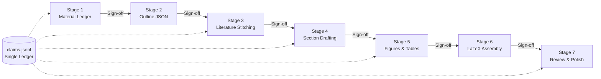

<div align="center">

# PaperLedger

**An evidence-tracked, seven-stage checkpointed research paper pipeline for coding agents.**

[](LICENSE)
[](pyproject.toml)
[](tests/)
[](skills/paper-orchestrator/SKILL.md)
[](THIRD_PARTY_NOTICES.md)

**English** | [简体中文](README_zh-CN.md)

</div>

> **Core Guarantee:** Every factual claim and number traces back to a verifiable source in `claims.jsonl`, and every stage pauses for explicit human sign-off. PaperLedger guarantees traceability—it never makes scientific judgments for you.

---

## Overview

**PaperLedger** (`paper-orchestrator`) is an open-source, checkpointed seven-stage pipeline for writing research papers with **Claude Code**, **Codex**, or **Antigravity**.

It ports the architectural foundation of Google's [PaperOrchestra](https://github.com/google-research/paper-orchestra)—structured outline JSON, multi-source literature stitching, figure/table generation, and LaTeX template assembly—into portable host-agent skills, then adds two safeguards generic writing skills lack:

1. **A Claims Ledger (`claims.jsonl`)** — Enforces strict L0–L4 evidence boundaries and verbatim numeric traceability across prose, inline math, and tables, eliminating hallucinated citations and fabricated numbers.
2. **A Calibrated Voice Pack (`voice-calibration.md`)** — Trained on 2023–2025 top-tier CS Best Paper corpora to remove AI-ese and defensive hedging while matching phrasing strength to actual evidence strength.

### Why PaperLedger?

| AI Writing Failure Mode | Typical Uncontrolled Output | PaperLedger Standard |
|---|---|---|
| **Fabricated Citations & Numbers** | *"Prior work reports 93.4% accuracy, and our tool improves on that result."* (93.4% is unverified; title/metadata-only L3 sources cannot back method details.) | *"Vartak et al. (2016) addressed machine-learning model management."* (Numbers must appear verbatim in the cited `origin` span or via a declared conversion; L3 is strictly whitelisted to Related Work.) |
| **AI-ese & Hollow Fluff** | *"This paper proposes a novel framework aiming to deeply explore the intrinsic mechanisms of the problem."* | *"We remove the per-token gate; training is 1.8× faster at equal accuracy."* (Concrete action, concrete verifiable number, zero filler.) |
| **Defensive Hedging** | *"The feasibility of this approach remains questionable and warrants further investigation."* | *"Achieves a 12.4% gain on X; next we evaluate generalization on dataset Y."* (State measured results directly, scope limitations concretely, and specify next steps.) |

---

## Architecture & Seven-Stage Pipeline

PaperLedger orchestrates specialized domain skills alongside four deterministic Python scripts. Every stage halts for human confirmation before advancing, and you can enter or resume from any stage `N` with automatic validation of upstream artifacts.



| Stage | Name | Primary Owner / Sibling Skill | Deterministic Script | Key Output / Gate |
|---|---|---|---|---|
| **1** | **Material Ledger** | `paper-orchestrator` | — | `claims.jsonl` populated from author materials (`material:<path>#L10-L15`) |
| **2** | **Outline JSON** | `tech-paper-template` / `benchmark-paper-template` | — | Structured `outline.json` with `lit_strategy` |
| **3** | **Literature Stitching** | `deep-research` | `lit_search.py` | Verified BibTeX (`--append --existing-bib`), numeric map, fresh-context citation check |
| **4** | **Section Drafting** | `paper-writer` / `intro-drafter` | `ledger_audit.py` | `sections/*.tex` with `% @claim:<id>` bindings (Abstract finalized after Stage 5) |
| **5** | **Figures & Tables** | `figure-designer` | `plot_from_logs.py` | Vector `.pdf` figures & `booktabs` `tables/*.tex` |
| **6** | **LaTeX Assembly** | `paper-orchestrator` | `latex_compose.py` | Assembled `manuscript/` package, stripped `% @claim:` tags, `.log`/`.blg` checks |
| **7** | **Self-Review & Polish** | `pre-submission-reviewer` + XOR (`paper-polish` \| `academic-humanizer`) | `ledger_audit.py` + `latex_compose.py` | Strict `7.1 → 7.5` sequence: strength-mismatch audit, single-pass polish, re-assembly |

---

## Core Mechanisms

### 1. Single Ledger (`claims.jsonl`) & L0–L4 Evidence Discipline

Every claim carries four required fields: `claim`, `origin`, `evidence_level`, and `boundary`. Every audited number in prose, inline data math (e.g., `$93.4\%$`, `$1.8\times$`), unit-suffixed figures, and tables must appear verbatim in its cited `origin` span or be derived via a declared whitelisted conversion (chained conversions supported).

| Level | Evidence Source | Allowed Claim Boundary | Numeric Claims |
|---|---|---|---|
| **L1** | Verified primary text / author experimental logs (`origin` line span) | Supports any technical, methodological, or empirical claim | Allowed (must match `origin` verbatim or via whitelisted conversion) |
| **L2** | Verified abstract / summary | Direction and headline findings only; no method steps or granular figures | Headline findings only |
| **L3** | Bibliographic metadata only (no abstract; AI `tldr` stripped by default) | Citation mention only (e.g., *"X et al. (Year) addressed Y"*), whitelisted strictly to Related Work | Forbidden |
| **L0** | Field common knowledge | General domain facts containing no numbers, proper nouns, or quantitative comparisons | Forbidden |
| **L4** | Unverified model memory | **Never enters the ledger** | Forbidden |

### 2. Four Deterministic Scripts

Mechanical, error-prone operations are never left to LLM improvisation:

| Script | Responsibility & Key Capabilities |
|---|---|
| `scripts/lit_search.py` | Multi-source search across Semantic Scholar, Crossref, and arXiv (`--queries-from outline.json`, `--source auto\|s2\|crossref\|arxiv`, `--append --existing-bib` for drift-free citekey locking, `--emit-ledger-draft`, `--emit-numeric-map`, `--rank`; strips AI `tldr` at L3 by default). |
| `scripts/plot_from_logs.py` | Deterministic vector PDF plotting and `booktabs` LaTeX table generation from CSV/JSONL (`--mode table` uses pure standard library without `matplotlib`; supports dual-channel encoding, error bars, `table*`, `bold_best`, and custom headers). |
| `scripts/latex_compose.py` | Template assembly, `sections/*.tex` and `--tables` wiring, `--outline` metadata injection (title/authors/paperID), automatic `\bibliography` sync and stale `.bib` cleanup, companion `.png` preview filtering, `[n] → \cite{key}` bridge, and `.log`/`.blg` diagnostic validation. |
| `scripts/ledger_audit.py` | Hard ledger gate and audit: L3 Related Work whitelist enforcement, block-level table `% @claim:` binding (`--tables`), inline data-math and unit-suffix numeric checks, chained whitelisted conversions, `--outline` and `--bib` checks, plus `--strength-report` and `--dispositions` fingerprint persistence. |

### 3. Design Contracts

- **Single Source of Truth:** Across Stages 4–7, edits happen exclusively in `sections/*.tex`, `tables/*.tex`, `outline.json`, and `claims.jsonl`. The compiled `manuscript/` directory is a pure build artifact regenerated by `latex_compose.py`.
- **Locked Stage 7 Sequence (`7.1 → 7.5`):** Any polish or revision must re-run `ledger_audit.py` (clearing strength mismatches) and `latex_compose.py` before final sign-off. The Abstract is finalized only after Stage 5 results and figures lock.
- **One Voice (Strict XOR):** Final polishing invokes **either** `paper-polish` (for Zh→En translation artifacts / Chinglish) **or** `academic-humanizer` (for native English AI-tone removal)—never both. Pre-submission verdicts belong solely to `pre-submission-reviewer`.
- **Pluggable Voice Pack:** `references/voice-calibration.md` is a swappable voice pack calibrated on 2023–2025 CS Best Papers. Follow [docs/voice-pack-training.md](docs/voice-pack-training.md) to train a replacement for other disciplines without touching pipeline rules. Runtime self-review rubrics live in `references/reflection-prompts.md`, while full upstream PaperOrchestra prompts are archived in [docs/upstream-prompts-archive.md](docs/upstream-prompts-archive.md).
- **Graceful Degradation:** If a host environment lacks any sibling skill, the host model assumes that stage directly while preserving all checkpoints, ledger rules, and audit gates—the pipeline never deadlocks.

---

## Quick Start

### Prerequisites

- **Python** `>= 3.11`
- **LaTeX toolchain** *(optional)* — If TeX is not installed, Stage 6 automatically falls back to a source-only verification package.

### 1. Install Skills

Copy the folders under `skills/` into your host agent's skills directory:

| Host Agent | Default Skills Directory |
|---|---|
| **Claude Code** | `~/.claude/skills/` |
| **Codex** | `~/.codex/skills/` |
| **Antigravity** | `~/.gemini/config/skills/` |

> Paths follow [tools/manifest.example.json](tools/manifest.example.json); adjust if your host version uses a custom root. On Windows, `~` maps to `%USERPROFILE%`.

#### Optional: Multi-Host Sync Utility

Use the cross-platform, standard-library sync script from the repository root (macOS / Linux / Windows):

```bash
# Preview changes without writing
python tools/sync_skills.py --manifest tools/manifest.example.json --dry-run

# Sync ./skills to Claude Code, Codex, and Antigravity
python tools/sync_skills.py --manifest tools/manifest.example.json

# Run built-in self-test
python tools/sync_skills.py --self-test
```

On Windows PowerShell:

```powershell
pwsh -NoProfile -File tools/sync-skills.ps1 `
  -ManifestPath tools/manifest.example.json -DryRun
pwsh -NoProfile -File tools/sync-skills.ps1 `
  -ManifestPath tools/manifest.example.json
```

> `optional_targets` (such as `~/.agents/skills`) are synced only when `--include-agents-root` (or `-IncludeAgentsRoot`) is explicitly passed. Neither script auto-creates missing target root directories or touches paths outside the manifest.

### 2. Trigger the Pipeline

In your host agent session:

- **Full end-to-end run:**
  ```text
  Use paper-orchestrator. Materials are in <dir>, target venue is <conference>.
  ```
- **Resume from a specific stage:**
  ```text
  Start paper-orchestrator from Stage 4; outline.json is at <path>.
  ```
- **Pause anytime:** Say `stop` at any checkpoint—all artifacts and `claims.jsonl` remain in the output directory for clean resumption.

*(Chinese trigger phrasing such as `用 paper-orchestrator，材料在 <目录>，目标是 <会议>` is equally supported.)*

---

## Repository Structure

```text
PaperLedger/
├── pyproject.toml                        # Dependencies & pytest configuration
├── skills/
│   ├── paper-orchestrator/               # Core 7-stage pipeline (Apache-2.0; 20 files)
│   │   ├── SKILL.md
│   │   ├── assets/                       # claims.jsonl & outline_template.json
│   │   ├── references/                   # Stage playbook, voice rules, voice pack, rubric
│   │   ├── scripts/                      # 4 deterministic Python scripts
│   │   └── templates/cvpr2025/           # CVPR 2025 author kit (original terms)
│   └── <9 sibling skills>/               # Bundled verbatim under original licenses
├── tools/
│   ├── sync_skills.py                    # Cross-platform stdlib multi-host sync (--self-test)
│   ├── sync-skills.ps1                   # Windows PowerShell sync script (-SelfTest)
│   └── manifest.example.json             # Default sync manifest (./skills -> 3 hosts)
├── tests/                                # Pytest suite, E2E pipeline tests & fixtures
├── docs/
│   ├── voice-pack-training.md            # Guide to training custom domain voice packs (ZH)
│   ├── upstream-prompts-archive.md       # Archived upstream PaperOrchestra prompts
│   └── licenses/                         # Verbatim third-party license texts
├── LICENSE                               # Apache-2.0
├── NOTICE                                # Apache-2.0 §4 upstream attribution
├── THIRD_PARTY_NOTICES.md                # Itemized third-party provenance & compliance
├── README.md                             # English documentation (default)
└── README_zh-CN.md                       # Simplified Chinese documentation
```

| Area | File Count |
|---|---|
| `skills/paper-orchestrator/` | 20 |
| 9 bundled sibling skills | 58 |
| `tools/` | 3 |
| `tests/` | 20 |
| `docs/` | 4 |

---

## Testing & Verification

### Install Dependencies

Full development and plotting dependencies:

```bash
pip install -e ".[dev]"
```

Minimal dependencies for core standard-library scripts and table-mode tests (without vector plotting):

```bash
pip install requests pyyaml pytest
```

### Verified Test Suites

- **Core deterministic suite** (requires no `matplotlib`, TeX, live network, or Windows junction privileges):
  ```bash
  python -m pytest tests/ --ignore=tests/test_plot_from_logs.py --ignore=tests/test_smoke.py --ignore=tests/test_sync_script.py -q -p no:cacheprovider
  ```
  **Result:** `147 passed` — covers ledger gates, L3 whitelisting, table-block & inline data-math audits, chained conversions, outline/BibTeX validation, multi-source `lit_search` citekey locking, `latex_compose` metadata injection & log checks, `plot_from_logs` table mode, Stage 7 contracts, `sync_skills.py` unit tests, E2E Stage 1→7 integration, and adversarial voice-calibration checks.

- **Cross-platform & PowerShell sync verification:**
  ```bash
  python -m pytest tests/test_sync_script.py -k "not selftest" -q -p no:cacheprovider
  python tools/sync_skills.py --self-test
  ```
  **Result:** `2 passed, 1 deselected`; `sync_skills.py --self-test` exits `0`.

- **Full test suite** (`python -m pytest tests/ -q -p no:cacheprovider`) additionally requires `matplotlib` (`test_plot_from_logs.py`, `test_smoke.py`) and a Windows PowerShell environment with NTFS junction permissions (`test_sync_script.py::test_selftest`). Byte integrity of the CVPR 2025 author kit is pinned via `tests/fixtures/cvpr2025_sha256.json`.

### E2E & Voice Pack Evaluation Boundaries

- [tests/test\_e2e\_pipeline.py](tests/test_e2e_pipeline.py) runs an automated Stage 1→7 walkthrough, intentionally injecting an unledgered `$99.9\%$` and an out-of-bounds L3 `\cite` into `03_approach.tex` to verify exit code `1`, then completes `tab_main.tex`, `--strength-report`, `--dispositions`, Stage 7 polish, and idempotent re-assembly.
- [tests/test\_voice\_calibration\_adversarial.py](tests/test_voice_calibration_adversarial.py) executes deterministic `ledger_audit` assertions and document-rule consistency checks against recorded host-model evaluation snapshots (no live LLM calls in `pytest`). Any modification to `voice-calibration.md` must be re-evaluated with fresh-context live LLM A/B/C testing per Step 6 of [docs/voice-pack-training.md](docs/voice-pack-training.md).

### Host Smoke-Test Status

| Host Environment | Status |
|---|---|
| **Claude Code** | `PASS` |
| **Antigravity (`agy`)** | `PASS` |
| **Codex Desktop App** | Pending manual confirmation |

---

## License & Third-Party Notices

- **First-party code & documentation:** Licensed under the **Apache License 2.0** ([LICENSE](LICENSE)). Code ported or adapted from `google-research/paper-orchestra` is attributed per Apache-2.0 §4 in [NOTICE](NOTICE).
- **Nine bundled third-party skills:** Retained verbatim under their respective original licenses (not re-licensed under Apache-2.0):
  - **8 skills from Supervisor-Skills** (Prof. Yuyu Luo & members, DIAL Lab, HKUST-GZ, © 2026) — Effective upstream license is **CC-BY-NC-SA-4.0** (**Non-Commercial**). Four skill frontmatters declare `CC-BY-4.0`, but this repository conservatively enforces the stricter repository-level `CC-BY-NC-SA-4.0` and documents the discrepancy.
  - **1 skill from academic-humanizer** (© 2026 AIScientists-Dev, **MIT**, lineage from `blader/humanizer`).
  - See [`THIRD_PARTY_NOTICES.md`](THIRD_PARTY_NOTICES.md) and [docs/licenses/](docs/licenses/) for itemized provenance and verbatim license texts. Verify non-commercial terms before any commercial use or redistribution.
- **CVPR 2025 Author Kit** (`skills/paper-orchestrator/templates/cvpr2025/`): Retained under its original conference/author-kit terms; `ieeenat_fullname.bst` is licensed under **LPPL** (© 1993–2007 Patrick W. Daly).

---

## Acknowledgments

- **[google-research/paper-orchestra](https://github.com/google-research/paper-orchestra)** (Apache-2.0) — Upstream origin for outline schema, literature retrieval, template assembly, and archived prompts.
- **[HKUSTDial/Supervisor-Skills](https://github.com/HKUSTDial/Supervisor-Skills)** — Prof. Yuyu Luo and members of the Data Intelligence and Analytics Lab (DIAL Lab), HKUST(GZ), for the 8 bundled sibling skills (`paper-writer`, `intro-drafter`, `tech-paper-template`, `benchmark-paper-template`, `deep-research`, `figure-designer`, `pre-submission-reviewer`, `paper-polish`).
- **[AIScientists-Dev/academic-humanizer](https://github.com/AIScientists-Dev/academic-humanizer)** (MIT; derived from [blader/humanizer](https://github.com/blader/humanizer)).
- **[cvpr-org/author-kit](https://github.com/cvpr-org/author-kit)** and Patrick W. Daly (`ieeenat_fullname.bst`).

<details>
<summary><strong>Default Voice Pack Calibration Corpus (8 Award-Winning Papers, 2024–2025)</strong></summary>

1. *Visual Autoregressive Modeling* (NeurIPS 2024 Best Paper)
2. *RHO-1: Not All Tokens Are What You Need* (NeurIPS 2024 Runner-Up)
3. *Genie: Generative Interactive Environments* (ICML 2024 Best Paper)
4. *Debating with More Persuasive LLMs Leads to More Truthful Answers* (ICML 2024 Best Paper)
5. *Safety Alignment Should Be Made More Than Just a Few Tokens Deep* (ICLR 2025 Outstanding)
6. *Learning Dynamics of LLM Finetuning* (ICLR 2025 Outstanding)
7. *Generative Image Dynamics* (CVPR 2024 Best Paper)
8. *Rich Human Feedback for Text-to-Image Generation* (CVPR 2024 Best Paper)

</details>

---

## Disclaimer

This project is an independent derivative work and is **not** affiliated with, sponsored by, or endorsed by Google. Authors using AI-assisted writing tools must comply with the AI-use disclosure policies of their target journal or conference. PaperLedger enforces claim traceability; scientific judgment—including problem selection, experimental design, conclusions, and submission responsibility—remains strictly with the authors.
