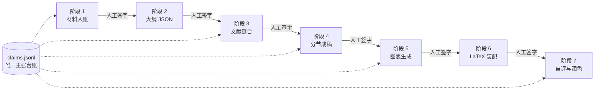

<div align="center">

# PaperLedger

**面向编程智能体的七阶段检查点科研论文流水线：一本账可溯源，一个声音去 AI 腔。**

[](LICENSE)
[](pyproject.toml)
[](tests/)
[](skills/paper-orchestrator/SKILL.md)
[](THIRD_PARTY_NOTICES.md)

[English](README.md) | **简体中文**

</div>

> **核心保证：** 每一条主张与数字都可在 `claims.jsonl` 中逐字溯源，每一个阶段产出后均暂停等待人类签字确认。流水线保证「可溯源」，绝不替作者做科学判断。

---

## 项目概述

**PaperLedger**（`paper-orchestrator`）是一套面向 **Claude Code**、**Codex** 与 **Antigravity** 宿主的开源七阶段检查点科研论文写作流水线。

它将 Google [PaperOrchestra](https://github.com/google-research/paper-orchestra) 的核心架构思想——结构化大纲 JSON、多源文献缝合、图表生成与 LaTeX 模板装配——移植为可跨宿主复用的 Agent Skills，并补齐了通用写作 skill 缺失的两道防线：

1. **主张台账（`claims.jsonl`）** —— 严格执行 L0–L4 证据边界与正文/表格/内联数学的逐字数值核验，彻底杜绝乱编数字与越界引用。
2. **顶刊校准声音包（`voice-calibration.md`）** —— 基于 2023–2025 年 CS 顶会最佳论文语料校准，消除防御性写作与 AI 腔，使措辞强度与真实证据强度严格匹配。

### 为什么需要 PaperLedger：AI 写论文的三大病

| 常见痛点 | 失控的 AI 写法 | PaperLedger 规范写法 |
|---|---|---|
| **乱引用、乱编数字** | *“Prior work reports 93.4% accuracy, and our tool improves on that result.”*（93.4% 无可核验原文区间；L3 题录不支持方法细节。） | *“Vartak et al. (2016) addressed machine-learning model management.”*（数字只能在 `origin` 原文区间或白名单换算中出现；L3 经白名单严格限定于 Related Work。） |
| **不说人话、AI 腔** | *“本文提出一种新颖的框架，旨在深入探究该问题的内在机理。”* | *“We remove the per-token gate; training is 1.8× faster at equal accuracy.”*（具体动作、具体数字、可核验，零空话。） |
| **防御性写作** | *“该方案的可行性依旧存疑，仍有待进一步研究。”* | *“在 X 上取得 12.4% 提升；下一步在 Y 数据集上验证泛化性。”*（把已测结果说直，把限制说具体，把下一步说明白。） |

---

## 整体架构与七阶段流水线

PaperLedger 将专业领域兄弟 skill 与四个确定性 Python 脚本编排为七阶段流水线。每阶段产出后停下等待用户签字（在会话中回复确认/继续），并支持从任意阶段 `N` 单点续跑（自动校验前序产物）。



| 阶段 | 名称 | 领域拥有者 / 兄弟 Skill | 确定性脚本 | 核心产出与门禁 |
|---|---|---|---|---|
| **1** | **材料入账** | `paper-orchestrator` | — | 从作者材料建立 `claims.jsonl`（支持 `material:<相对路径>#L10-L15`） |
| **2** | **大纲 JSON** | `tech-paper-template` / `benchmark-paper-template` | — | 生成含 `lit_strategy` 的结构化 `outline.json` |
| **3** | **文献缝合** | `deep-research` | `lit_search.py` | 多源检索、锁键 BibTeX（`--append --existing-bib`）、数字映射表与独立上下文引用核查 |
| **4** | **分节成稿** | `paper-writer` / `intro-drafter` | `ledger_audit.py` | 带 `% @claim:<id>` 绑定的 `sections/*.tex`（Abstract 留待阶段 5 后定稿） |
| **5** | **图表生成** | `figure-designer` | `plot_from_logs.py` | 矢量 `.pdf` 图表与 `booktabs` `tables/*.tex` |
| **6** | **LaTeX 装配** | `paper-orchestrator` | `latex_compose.py` | 生成 `manuscript/` 源码包、自动剥离 `% @claim:`、校验 `.log`/`.blg` |
| **7** | **自评与润色** | `pre-submission-reviewer` + XOR（`paper-polish` \| `academic-humanizer`） | `ledger_audit.py` + `latex_compose.py` | 严格锁定 `7.1 → 7.5`：证据强度审计、单通道润色、幂等重装配 |

---

## 核心机制

### 1. 一本账（`claims.jsonl`）与 L0–L4 证据刻度

每条主张必须包含 `claim`、`origin`、`evidence_level`、`boundary` 四个字段。正文与表格中的每个受审数字（含数据性内联数学如 `$93.4\%$`、`$1.8\times$` 与单位后缀数字）都必须能在被引 claim 的 `origin` 原文区间中逐字找到，或由声明过的白名单换算（支持链式换算）得出。

| 级别 | 证据来源 | 允许的主张边界 | 数值主张规则 |
|---|---|---|---|
| **L1** | 经核验的原文区间 / 作者实验日志（`origin` 行区间） | 支持任何技术、方法或实验主张 | 允许（需逐字匹配或经白名单换算） |
| **L2** | 经核验的摘要 / 概要 | 仅支持方向与 headline findings，禁止方法步骤与细粒度数值 | 仅限 headline findings |
| **L3** | 仅题录元数据（无摘要；默认剥离 AI `tldr`） | 仅支持题录指称（如 *“X et al. (Year) addressed Y”*），经白名单限定于 Related Work | 禁止 |
| **L0** | 领域常识 | 不含数字、专名或量化对比的通用领域事实 | 禁止 |
| **L4** | 模型记忆 | **永不入账** | 禁止 |

### 2. 四个确定性脚本

机械、易出错的工程任务绝不交给大模型即兴发挥：

| 脚本 | 职责与核心能力 |
|---|---|
| `scripts/lit_search.py` | Semantic Scholar / Crossref / arXiv 多源检索（支持 `--queries-from outline.json`、`--source auto\|s2\|crossref\|arxiv`、`--append --existing-bib` 锁键不漂移、`--emit-ledger-draft`、`--emit-numeric-map`、`--rank`，L3 默认剥离 AI `tldr`）。 |
| `scripts/plot_from_logs.py` | 从 CSV/JSONL 确定性绘制矢量 `.pdf` 图与 `booktabs` 表格（`--mode table` 纯标准库无需 `matplotlib`；支持双通道编码、误差棒、`table*`、`bold_best`、自定义表头）。 |
| `scripts/latex_compose.py` | 模板装配、`sections/*.tex` 与 `--tables` 接线、`--outline` 元数据注入（标题/作者/paperID）、`\bibliography` 自动同步并清理残留 `.bib`、过滤伴随 `.png` 预览、`[n] → \cite{key}` 桥及 `.log`/`.blg` 编译诊断校验。 |
| `scripts/ledger_audit.py` | 台账硬门禁与审计：L3 Related Work 白名单限制、表格块级 `% @claim:` 绑定与 `--tables`、数据性内联数学与单位后缀数字审计、链式白名单换算、`--outline` 与 `--bib` 校验，以及 `--strength-report` + `--dispositions` 处置指纹持久化。 |

### 3. 关键设计契约

- **单一事实源：** 阶段 4–7 全程只修改 `sections/*.tex`、`tables/*.tex`、`outline.json`、`claims.jsonl`；`manuscript/`（编译输出目录）仅由 `latex_compose.py` 重建，禁止手工修改。
- **阶段 7 严格顺序（`7.1 → 7.5`）：** 任何编辑与润色后必须重跑 `ledger_audit.py`（清零强度错配）并重跑 `latex_compose.py` 刷新终稿。Abstract 在阶段 5 实验与图表定型后最终定稿。
- **一个声音（严格 XOR）：** 收尾润色仅调用 `paper-polish`（存在中译英/中式英语残留）**或** `academic-humanizer`（纯英文去 AI 味）之一，禁止两者叠加；评审结论唯一归属 `pre-submission-reviewer`。
- **声音包与提示词解耦：** `references/voice-calibration.md` 是可替换的声音包插槽，出厂版在 2023–2025 年 CS 顶会最佳论文语料上校准；其他学科可按 [docs/voice-pack-training.md](docs/voice-pack-training.md) 自训替换。运行时自评 Rubric 位于 `references/reflection-prompts.md`，上游 PaperOrchestra 原始提示词归档位于 [docs/upstream-prompts-archive.md](docs/upstream-prompts-archive.md)。
- **优雅降级：** 宿主未安装某个兄弟 skill 时，该阶段由宿主模型直接承担；检查点、台账与审计规则不变，流水线绝不因缺少 skill 死锁。

---

## 快速开始

### 环境要求

- **Python** `>= 3.11`
- **LaTeX 工具链** *（可选）* —— 未安装 TeX 时，阶段 6 自动回退为源码级检查与打包交付。

### 1. 安装 Skill

将 `skills/` 下的文件夹整体复制到对应宿主的 skills 目录：

| 宿主环境 | 默认 skills 目录 |
|---|---|
| **Claude Code** | `~/.claude/skills/` |
| **Codex** | `~/.codex/skills/` |
| **Antigravity** | `~/.gemini/config/skills/` |

> 路径以 [tools/manifest.example.json](tools/manifest.example.json) 示例为准；不同宿主版本如有差异请按其官方文档调整。Windows 下 `~` 对应 `%USERPROFILE%`。

#### 可选：多宿主同步脚本

推荐在仓库根目录运行跨平台纯标准库脚本 `tools/sync_skills.py`（支持 macOS / Linux / Windows）：

```bash
# 预演同步计划（不实际写入）
python tools/sync_skills.py --manifest tools/manifest.example.json --dry-run

# 同步 ./skills 至 Claude Code、Codex 与 Antigravity
python tools/sync_skills.py --manifest tools/manifest.example.json

# 运行内置自检
python tools/sync_skills.py --self-test
```

Windows PowerShell 用户也可使用 `tools/sync-skills.ps1`：

```powershell
pwsh -NoProfile -File tools/sync-skills.ps1 `
  -ManifestPath tools/manifest.example.json -DryRun
pwsh -NoProfile -File tools/sync-skills.ps1 `
  -ManifestPath tools/manifest.example.json
```

> `optional_targets`（如 `~/.agents/skills`）仅在显式传入 `--include-agents-root`（或 PowerShell `-IncludeAgentsRoot`）时同步；两个脚本均绝不自动创建缺失的目标根目录，也不触碰 manifest 之外的任何路径。

### 2. 触发流水线

在宿主会话中直接输入：

- **全流程：** `用 paper-orchestrator，材料在 <目录>，目标是 <会议>`
- **单阶段续跑：** `从 paper-orchestrator 阶段4开始，outline.json 在 <路径>`
- **随时暂停：** 在任意检查点回复「停」，所有产物与台账保留在输出目录，随时可续跑。

---

## 目录结构

```text
PaperLedger/
├── pyproject.toml                        # 依赖声明与 pytest 配置
├── skills/
│   ├── paper-orchestrator/               # 核心七阶段流水线（Apache-2.0；20 files）
│   │   ├── SKILL.md
│   │   ├── assets/                       # claims 台账 / outline 模板
│   │   ├── references/                   # 阶段手册、声音规则、voice pack、自评 Rubric
│   │   ├── scripts/                      # 四个确定性 Python 脚本
│   │   └── templates/cvpr2025/           # CVPR 2025 作者套件（保留原条款）
│   └── <9 个兄弟 skill>/                  # 原样保留，各自遵循原许可证
├── tools/
│   ├── sync_skills.py                    # 跨平台纯标准库多宿主镜像（含 --self-test）
│   ├── sync-skills.ps1                   # Windows PowerShell 镜像脚本（含 -SelfTest）
│   └── manifest.example.json             # 示例 manifest（./skills -> 3 个默认宿主目录）
├── tests/                                # pytest 套件、端到端集成测试与 fixtures
├── docs/
│   ├── voice-pack-training.md            # 声音包自训配方（中文）
│   ├── upstream-prompts-archive.md       # 上游 PaperOrchestra 原始提示词归档
│   └── licenses/                         # 第三方许可证全文（逐字收录上游）
├── LICENSE                               # Apache-2.0
├── NOTICE                                # Apache-2.0 §4 上游归属
├── THIRD_PARTY_NOTICES.md                # 第三方逐项溯源与合规提示
├── README.md                             # 英文文档（默认）
└── README_zh-CN.md                       # 简体中文文档
```

| 区域 | 文件数 |
|---|---|
| `skills/paper-orchestrator/` | 20 |
| 9 个兄弟 skill | 58 |
| `tools/` | 3 |
| `tests/` | 20 |
| `docs/` | 4 |

---

## 测试与验证

### 安装依赖

完整开发与绘图依赖：

```bash
pip install -e ".[dev]"
```

仅运行核心纯标准库与表格模式工具链（不渲染矢量图表）：

```bash
pip install requests pyyaml pytest
```

### 已验证测试范围

- **核心确定性套件**（无需 `matplotlib`、TeX、实时网络或 Windows junction 权限）：
  ```bash
  python -m pytest tests/ --ignore=tests/test_plot_from_logs.py --ignore=tests/test_smoke.py --ignore=tests/test_sync_script.py -q -p no:cacheprovider
  ```
  **结果：`147 passed`** —— 覆盖台账门禁、L3 白名单、表格块与内联数据数学审计、链式换算、纲要与引文校验、`lit_search` 多源检索与不漂移锁键、`latex_compose` 元数据注入与编译日志检查、`plot_from_logs` 表格生成、多 skill 冲突与阶段 7 顺序契约、`sync_skills.py` 单测、阶段 1→7 端到端集成与对抗样本机检。

- **跨平台与 PowerShell 同步校验：**
  ```bash
  python -m pytest tests/test_sync_script.py -k "not selftest" -q -p no:cacheprovider
  python tools/sync_skills.py --self-test
  ```
  **结果：** `test_sync_script.py -k "not selftest"` 为 `2 passed, 1 deselected`；`sync_skills.py --self-test` 退出 `0`。

- **完整全套测试**（`python -m pytest tests/ -q -p no:cacheprovider`）额外依赖 `matplotlib`（`test_plot_from_logs.py`、`test_smoke.py`）与具备创建 NTFS junction 权限的 Windows PowerShell 环境（`test_sync_script.py::test_selftest`）。公开仓库不附带 `vendor/` 上游 clone，CVPR 作者套件字节一致性由 `tests/fixtures/cvpr2025_sha256.json` 固定。

### 端到端与声音包评测边界

- [tests/test\_e2e\_pipeline.py](tests/test_e2e_pipeline.py) 覆盖阶段 1→7 自动化演练，在 `03_approach.tex` 中故意植入未入账 `$99.9\%$` 与越界 L3 `\cite` 验证双违规必返回 exit 1，随后完成 `tab_main.tex`、`--strength-report`、`--dispositions`、阶段 7 润色与幂等重新装配。
- [tests/test\_voice\_calibration\_adversarial.py](tests/test_voice_calibration_adversarial.py) 在 `pytest` 中仅对**历史宿主模型评测记录快照**运行确定性 `ledger_audit` 断言、文档规则一致性与 B 组改写非捏造数字检查（不调用实时大模型）；任何对 `voice-calibration.md` 的修改都必须按 [docs/voice-pack-training.md](docs/voice-pack-training.md) 第 6 步重开干净上下文完成实时 LLM A/B/C 复测。

### 宿主加载冒烟状态

| 宿主环境 | 状态 |
|---|---|
| **Claude Code** | `PASS` |
| **Antigravity (`agy`)** | `PASS` |
| **Codex 桌面端** | 待人工确认（确认前不声称三端全绿） |

---

## 许可证与第三方声明

- **本仓自有代码与文档：** 采用 **Apache-2.0** 许可证（[LICENSE](LICENSE)）。搬入/改写的 `google-research/paper-orchestra` 代码按 Apache-2.0 §4 在 [NOTICE](NOTICE) 中署名（含仓库 URL、commit 与文件清单）。
- **9 个第三方兄弟 skill：** 原样保留各自许可证，不因与 Apache-2.0 代码同树而改变：
  - **8 个来自 Supervisor-Skills**（港科广 HKUST-GZ DIAL Lab，骆昱宇 Yuyu Luo 教授及成员，© 2026）：上游仓库的 [LICENSE](docs/licenses/LICENSE-Supervisor-Skills.txt) 为 **CC-BY-NC-SA-4.0**（含**非商用**条款；其中 4 个目录 frontmatter 标 `CC-BY-4.0`，本仓从严按 `CC-BY-NC-SA-4.0` 处理并记录差异）。
  - **1 个来自 academic-humanizer**（© 2026 AIScientists-Dev，**MIT**，谱系基于 `blader/humanizer`）。
  - 逐项溯源与许可证全文见 [`THIRD_PARTY_NOTICES.md`](THIRD_PARTY_NOTICES.md) 与 [docs/licenses/](docs/licenses/)；商用或再分发前请核对非商用条款。
- **CVPR 2025 作者套件**（`skills/paper-orchestrator/templates/cvpr2025/`）：按会议/作者套件原条款保留；`ieeenat_fullname.bst` 采用 **LPPL**（© 1993–2007 Patrick W. Daly）。

---

## 致谢

- **[google-research/paper-orchestra](https://github.com/google-research/paper-orchestra)**（Apache-2.0）：大纲 schema、文献检索、模板装配与提示词归档的上游出处。
- **[HKUSTDial/Supervisor-Skills](https://github.com/HKUSTDial/Supervisor-Skills)**：香港科技大学（广州）数据智能与分析实验室 DIAL Lab，骆昱宇（Yuyu Luo）助理教授及实验室成员，提供 8 个兄弟 skill（`paper-writer`、`intro-drafter`、`tech-paper-template`、`benchmark-paper-template`、`deep-research`、`figure-designer`、`pre-submission-reviewer`、`paper-polish`）。
- **[AIScientists-Dev/academic-humanizer](https://github.com/AIScientists-Dev/academic-humanizer)**（MIT；基于 [blader/humanizer](https://github.com/blader/humanizer)）。
- **[cvpr-org/author-kit](https://github.com/cvpr-org/author-kit)** 与 Patrick W. Daly（`ieeenat_fullname.bst`）。

<details>
<summary><strong>出厂声音包校准语料（2024–2025 年 8 篇顶会最佳论文）</strong></summary>

1. *Visual Autoregressive Modeling*（NeurIPS 2024 Best Paper）
2. *RHO-1: Not All Tokens Are What You Need*（NeurIPS 2024 Runner-Up）
3. *Genie: Generative Interactive Environments*（ICML 2024 Best Paper）
4. *Debating with More Persuasive LLMs Leads to More Truthful Answers*（ICML 2024 Best Paper）
5. *Safety Alignment Should Be Made More Than Just a Few Tokens Deep*（ICLR 2025 Outstanding）
6. *Learning Dynamics of LLM Finetuning*（ICLR 2025 Outstanding）
7. *Generative Image Dynamics*（CVPR 2024 Best Paper）
8. *Rich Human Feedback for Text-to-Image Generation*（CVPR 2024 Best Paper）

</details>

---

## 声明

本项目是独立衍生作品，与 Google 无隶属关系，也未获其背书。AI 辅助写作应遵守目标期刊/会议的 AI 使用披露政策。流水线保证的是「每个主张可溯源」，不替作者做科学判断：选题、实验设计、结论取舍与投稿责任仍在作者。
